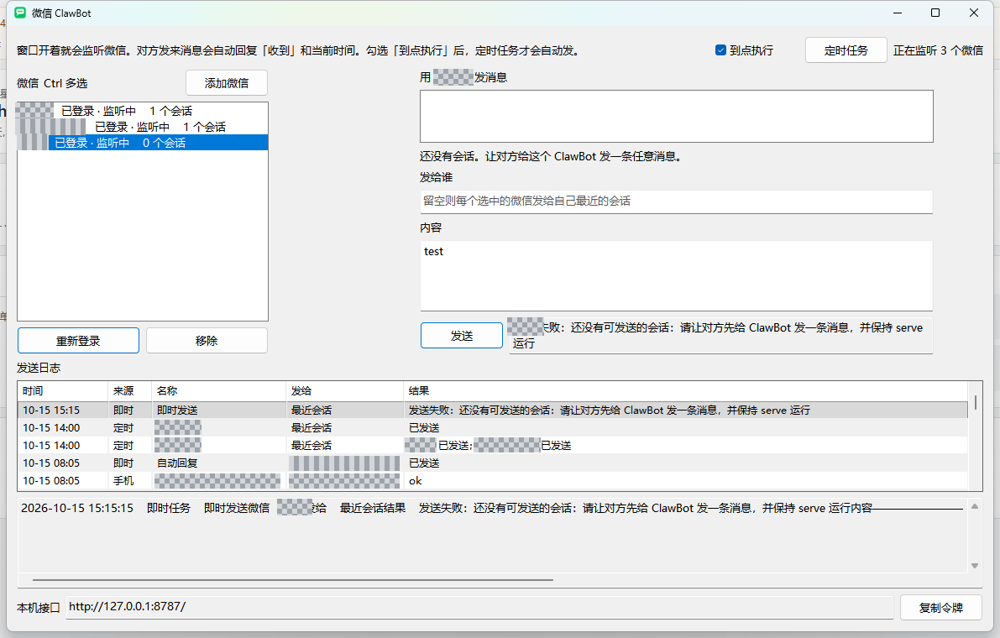
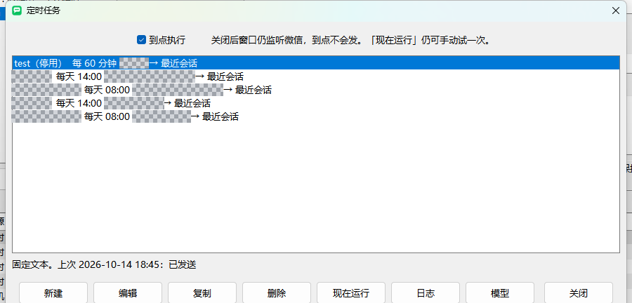
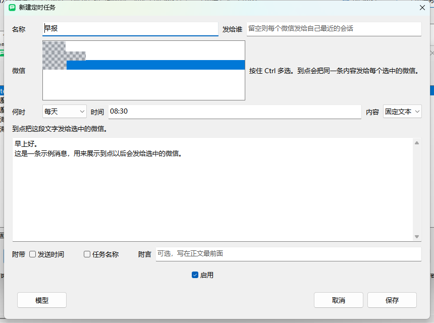

# WeixinClawBot

在本机用微信官方 iLink ClawBot 给个人微信发消息。桌面窗口、命令行和本机 HTTP 接口都能用。

对方需要先给这个 ClawBot 发过一条消息，程序才能拿到会话令牌。这个令牌和扫码登录不是一回事，微信也不提供过期时间。

## 界面



主窗口用来添加微信、看会话、写消息。下面是发送日志。账号、用户 ID 和任务名已打码。



定时任务列表。勾选「到点执行」后，到点才会自动发。



新建一条每天发送的文本任务。图中的名称和正文是示例，微信号已打码。

## 能做什么

- 多个微信各自扫码。窗口开着就一起监听，之后新扫码的也会自动开始监听。
- 按住 Ctrl 多选微信，同一条内容分别发出去。接收者留空时，各自发给最近的会话。
- 对方从手机发来消息时，自动回复「收到」和当前时间。发来任务序号或查询号时，立刻重跑那条定时任务，把这次的结果发回去。
- 定时发送一段文字、一条本机命令的输出、一个网页正文、接口 JSON 里的指定字段，或一次浏览分析的结论。
- 在 `127.0.0.1:8787` 提供只绑定本机的发消息接口。

## 桌面程序

```bash
go build -ldflags "-H windowsgui" -o WeixinClawBot.exe ./cmd/weixinclawbot
```

双击 `WeixinClawBot.exe`，或：

```bash
go run ./cmd/weixinclawbot gui
```

1. 点「添加微信」，每个微信用途单独扫一次码。
2. 用该微信给 ClawBot 发一条任意消息。窗口开着时，这条消息会换成新的会话令牌。
3. 在右侧写内容，点「发送」。

关掉窗口就停止监听。

## 定时任务

在主窗口点「定时任务」。一个任务可以按住 Ctrl 选择多个微信，到点把同一条内容分别发出去。新建的任务不会马上执行。桌面窗口或 `serve` 开着才会到点运行。

列表左侧是从 1 开始的序号。编辑任务时可以再填一个查询号。对方给 ClawBot 发序号或查询号，会立刻重跑这条任务，收到的就是这次生成的内容，和到点自动发送的正文一样。查询号和序号写成一样时，按查询号找。

| 内容 | 到点做什么 |
| --- | --- |
| 固定文本 | 把这段文字发出去 |
| 运行命令 | 执行本机命令，发送输出。大约最多 45 秒 |
| 抓取页面 | 填写 http 或 https 网址。普通网页直接读正文；靠脚本画出来的页面，用本机已经登录的 Edge 或 Chrome 打开，等页面和请求都加载完再读出文字，然后关掉这个新窗口。大约最多等 75 秒 |
| 接口数据 | 请求一个接口。没有勾选字段时，把返回的 JSON 直接发出去；勾选后只发这些路径。大约最多等 20 秒 |
| 浏览分析 | 第一行写网址，下面写要回答的问题。后台打开页面，模型只按这个问题点击、输入或滚动，再把结论发出去。大约最多 3 分钟 |

接口的方法和地址在同一行，旁边是「发送」。参数、请求头、正文、字段分成四栏，返回显示在下面。点「发送」后，返回区最上面是这次实际请求的完整 curl，任务日志里也会留下同一条。需要提交内容时把方法改成 POST。

几个任务共用的参数可以收成宏。定时任务窗口点「宏」，用「新建」或「编辑」填写名称和值，例如名称 `token`。任务的网址、参数、请求头、正文、命令或附言里写 `{token}`。到点运行或对方发来查询号时才换成当时保存的值，所以改一次宏，用到它的任务都会换上新值。任务里仍然保存 `{token}`，不会写成具体密钥。

地址、参数、请求头和正文里可以写日期变量：

- `{today}`、`{yesterday}` 换成 `20261014`、`20261013`
- `{today-yyyy-mm-dd}`、`{yesterday-yyyy-mm-dd}` 换成 `2026-10-14`、`2026-10-13`

列表路径写成 `data.list.*.name`。单位接在字段后面，例如 `data.list.*.amount元`。金额如果是分，先换算再写单位，例如 `data.list.*.cost/100元`。

浏览分析要先在「模型」里填写接口，保存在数据目录的 `ai.json`。页面上的文字不会被当成新的指示。需要登录时可以加一行 `Cookie: 名称=值`。如果本机 Chrome 或 Edge 里这个网站已经登录，会把登录状态复制到临时窗口里操作，做完就关掉。

主窗口和定时任务窗口里的「到点执行」可以整组关掉。关掉后仍会监听微信，到点不会发，这段时间错过的任务也不会在重新打开后补发。「现在运行」不受这个开关影响。每天的任务如果当天过了时间还没跑，只补今天这一次。

任务保存在数据目录的 `schedules.json`。输出过长会截断后再发送。

## 命令行

```bash
go run ./cmd/weixinclawbot login -name 工作
go run ./cmd/weixinclawbot list
go run ./cmd/weixinclawbot serve
```

`list` 在终端里列出全部微信和各自的会话。`↑↓` 选微信，`←→` 选会话，`Enter` 写一条测试消息并发送，`r` 刷新，`q` 退出。

`login` 会在命令行里画出二维码，并用画图打开图片。扫码确认后，用该微信给 ClawBot 发一条任意消息。`serve` 会同时监听全部已登录微信。

另开一个终端发送。只有一个微信时可以不写 `-account`：

```bash
go run ./cmd/weixinclawbot send -account 工作 你好
go run ./cmd/weixinclawbot send -account 工作 -to 用户ID 你好
go run ./cmd/weixinclawbot sessions
```

## 本机接口

`serve` 和桌面窗口都在 `127.0.0.1:8787` 提供发消息接口。本地令牌启动时打印，也保存在 `data/api_token.txt`，窗口里可以复制。

```bash
curl -X POST http://127.0.0.1:8787/v1/messages \
  -H "Authorization: Bearer <api_token>" \
  -H "Content-Type: application/json" \
  -d "{\"account\":\"工作\",\"text\":\"你好\"}"
```

多个微信时，请求体里的 `account` 必填。`GET /v1/accounts` 查看已登录微信，`GET /v1/sessions` 查看每个微信下的会话状态。接口只绑定本机，不返回 `context_token`。

## 会话令牌

每次发送都会拿上次的令牌再请求微信。微信拒绝后，会话会标成已拒绝，下次定时任务仍会再试。只有微信继续拒绝时，才需要对方再发一条消息。

超过 24 小时，或自上次收到消息后已发约 10 条时，会话会提示风险，但不会提前拦截。失败原因写在主窗口下方的发送日志里，包括令牌是什么时候拿到的、此后发过几条，以及微信返回的错误码。

对方从手机发给 ClawBot 的内容、主窗口的即时发送，以及每次定时任务，都记在 `task-log.json`。主窗口下方可以直接看，会话旁边也会显示最近一条手机消息。定时任务窗口的「日志」打开的是同一份记录，最多保留最近 200 条。

## 配置

可选环境变量：

- `WEIXIN_DATA_DIR`：数据目录
- `WEIXIN_LISTEN`：监听地址
- `WEIXIN_API_TOKEN`：本机接口令牌
- `WEIXIN_AI_BASE`、`WEIXIN_AI_KEY`、`WEIXIN_AI_MODEL`：模型接口，这三项会盖过 `ai.json`
